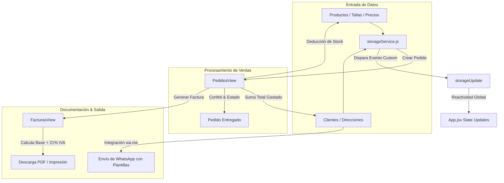

# 📖 Documentación Completa del Sistema: ModaInma Management Web App

---

## 📋 1. Visión General de la Aplicación

**ModaInma Management** es una aplicación web progresiva (PWA) de gestión comercial integral diseñada específicamente para boutiques y tiendas de moda. La aplicación abarca todo el ciclo operativo del negocio: desde la gestión de inventario por tallas y precios de coste/venta, la administración de clientes y su historial de compras, hasta la creación de pedidos, generación de facturas oficiales con IVA (21%) y el envío de notificaciones personalizadas por WhatsApp.

### 🎯 Objetivos de Negocio y Características Clave
- **Control Total de Stock y Márgenes:** Seguimiento minucioso de prendas por categorías y tallas (XS a XL), calculando automáticamente el margen de beneficio neto en euros y porcentaje.
- **Flujo de Ventas y Pedidos Simplificado:** Embudo de estados de pedidos (Pendiente ➔ Preparando ➔ Listo ➔ Enviado ➔ Entregado) con validación automática de disponibilidad en stock.
- **Facturación Automatizada:** Conversión instantánea de pedidos en facturas legales con desglose de Base Imponible e IVA (21%), listas para descargar e imprimir en formato PDF.
- **CRM y Fidelización de Clientes:** Fichas de cliente con historial acumulado de compras, cálculo de total gastado, notas privadas y comunicación directa vía WhatsApp Web / App mediante plantillas de mensajes personalizables.
- **Búsqueda Global Spotlight:** Paleta de comandos omnibox para encontrar al instante cualquier cliente, producto, pedido o factura desde cualquier parte de la aplicación.
- **Modo Offline & PWA:** Totalmente funcional en navegador, tablets o móviles sin necesidad de servidor backend obligatorio, con persistencia local y soporte para instalación como app nativa.

---

## 🏗️ 2. Arquitectura y Estructura del Código

La aplicación está construida con una arquitectura moderna de React basada en componentes funcionales, modulares y desacoplados.

```
pagina_inma/
├── index.html                  # Punto de entrada HTML5 con fuentes tipográficas e iconos
├── vite.config.js              # Configuración del bundler Vite con React plugin
├── package.json                # Dependencias (React 19, Lucide, jsPDF, html2canvas, canvas-confetti)
├── public/
│   ├── favicon.svg             # Logotipo e icono de la aplicación
│   ├── manifest.json           # Manifiesto PWA para instalación en móviles/escritorio
│   └── sw.js                   # Service Worker para caché offline y PWA
└── src/
    ├── main.jsx                # Renderizado principal de React en el DOM
    ├── index.css               # Sistema de diseño global (Tokens CSS, paleta pastel, componentes UI)
    ├── App.jsx                 # Componente Orquestador Principal (Estado global, routing interno y modales)
    ├── App.css                 # Modificadores de layout global
    ├── services/               # Capa de Servicios y Lógica de Datos
    │   ├── storageService.js   # Motor de persistencia en LocalStorage con sistema Pub/Sub
    │   ├── mockData.js         # Datos de demostración iniciales (Prendas, Clientes, Pedidos, etc.)
    │   └── firebase.js         # Conector/Adaptador preparado para sincronización Cloud con Firebase
    └── components/             # Vistas de la aplicación y componentes de interfaz
        ├── Sidebar.jsx         # Menú lateral de navegación con contadores y badges reactivos
        ├── TopBar.jsx          # Barra superior con buscador omnibox y acciones rápidas
        ├── GlobalSearchModal.jsx # Modal de búsqueda global Spotlight (Filtro multiplataforma)
        ├── ToastNotification.jsx # Notificaciones flotantes no bloqueantes
        ├── Dashboard/
        │   └── DashboardView.jsx # Panel principal de métricas KPI, accesos directos y tareas
        ├── Clientes/
        │   └── ClientesView.jsx  # Gestión de clientes, historial de compras y envío de WhatsApp
        ├── Productos/
        │   └── ProductosView.jsx # Catálogo de ropa, gestión de stock por talla y cálculo de márgenes
        ├── Pedidos/
        │   └── PedidosView.jsx   # Embudo de pedidos, emisión de tickets y celebración de entregas
        ├── Facturas/
        │   └── FacturasView.jsx  # Generación de facturas en PDF y control de cobros
        └── Plantillas/
            └── PlantillasView.jsx # Gestor de plantillas de WhatsApp con variables dinámicas
```

---

## ⚡ 3. Funcionamiento e Integración Técnica del Código

### 🔄 3.1 Flujo de Datos y Persistencia (Storage Engine + Event-Driven Sync)
La aplicación utiliza una estrategia de persistencia reactiva en el cliente a través de [storageService.js](file:///c:/Users/user/Desktop/pagina_inma/src/services/storageService.js):

1. **Almacenamiento Local (LocalStorage):** Todas las entidades (`products`, `clients`, `orders`, `invoices`, `templates`, `tasks`) se guardan estructuradas en `localStorage` mediante la clave de versión `v3_modainma_demo_ready`.
2. **Patrón Observador / Eventos Personalizados (`storageUpdate`):**
   Cada vez que una función de `storageService.js` (como `saveProduct`, `saveOrder`, `toggleTask`) modifica el almacenamiento, dispara un evento global de JavaScript:
   ```javascript
   const notifyStorageChange = (key) => {
     window.dispatchEvent(new CustomEvent('storageUpdate', { detail: { key } }));
   };
   ```
3. **Reactividad en [App.jsx](file:///c:/Users/user/Desktop/pagina_inma/src/App.jsx):**
   El componente raíz escucha dicho evento en su `useEffect`:
   ```javascript
   useEffect(() => {
     loadAllData();
     const handleStorageUpdate = () => loadAllData();
     window.addEventListener('storageUpdate', handleStorageUpdate);
     return () => window.removeEventListener('storageUpdate', handleStorageUpdate);
   }, []);
   ```
   Esto garantiza que **cualquier cambio en cualquier vista actualice instantáneamente los contadores, insignias y estados de toda la aplicación** sin recargar la página.

---

### 🧩 3.2 Desglose Módulo por Módulo

#### 1️⃣ **Dashboard (Panel de Control Principal)** - [DashboardView.jsx](file:///c:/Users/user/Desktop/pagina_inma/src/components/Dashboard/DashboardView.jsx)
- **Función:** Proporcionar un resumen ejecutivo en tiempo real de la salud financiera y operativa de la tienda.
- **Integración de Código:**
  - Calcula ventas totales acumuladas, recuento de pedidos pendientes, alertas de stock bajo y facturación acumulada del mes en curso.
  - Incluye un gestor de **Tareas Pendientes Operativas** conectadas a `getTasks()`, `addTask()` y `toggleTask()`.
  - Permite cargar datos de demo (`loadDemoData()`) o reiniciar la base de datos (`clearAllData()`).

#### 2️⃣ **Catálogo de Productos & Inventario** - [ProductosView.jsx](file:///c:/Users/user/Desktop/pagina_inma/src/components/Productos/ProductosView.jsx)
- **Función:** Administración de prendas de vestir, costes, precios al público, imágenes y stock detallado por talla.
- **Integración de Código:**
  - **Matriz de Tallas:** Maneja la estructura de datos `variants: [{ size: 'XS', stock: 5 }, ...]`.
  - **Cálculo Financiero en Tiempo Real:** Calcula el beneficio neto (`salePrice - costPrice`) y el porcentaje de margen (`(beneficio / salePrice) * 100`).
  - **Soporte Multimedia:** Permite seleccionar imágenes predefinidas de modelos o cargar fotografías propias desde el dispositivo codificadas en Base64 `FileReader`.
  - **Filtros Dinámicos:** Búsqueda por texto (nombre/SKU), por categoría (`Vestidos`, `Blusas`, `Pantalones`, etc.) y por estado de stock (`Stock Bajo ⚠️`, `Agotados`, `En Stock`).

#### 3️⃣ **Gestión de Clientes & CRM** - [ClientesView.jsx](file:///c:/Users/user/Desktop/pagina_inma/src/components/Clientes/ClientesView.jsx)
- **Función:** Registrar la información de los compradores, analizar su histórico de pedidos y facilitar la comunicación directa.
- **Integración de Código:**
  - **Ficha del Cliente & Historial:** Relaciona el `clientId` con los registros de la colección `orders` para mostrar las compras pasadas y la fecha de última transacción.
  - **Integración WhatsApp Directa:** Transforma los teléfonos al formato internacional (`34xxxxxxxxx`) y abre enlace seguro a `https://wa.me/` aplicando las plantillas personalizadas.
  - **Acciones Rápidas:** Copiado de dirección de envío en 1 clic al portapapeles, llamada telefónica rápida (`tel:`) y correo electrónico (`mailto:`).

#### 4️⃣ **Gestión de Pedidos & Ventas** - [PedidosView.jsx](file:///c:/Users/user/Desktop/pagina_inma/src/components/Pedidos/PedidosView.jsx)
- **Función:** Procesar ventas, asignar prendas y tallas a clientes, seguir el ciclo de entrega y emitir recibos/tickets.
- **Integración de Código:**
  - **Creación de Pedido:** Selección interactiva de cliente existente o registro express de cliente nuevo, sumado a un carrito de compra con selección de prendas y tallas disponibles.
  - **Actualización Automática de Métricas de Cliente:** Al guardar un pedido, `storageService.js` actualiza automáticamente el `totalSpent` del cliente en su ficha.
  - **Celebración de Entregas:** Cuando un pedido cambia su estado a `Entregado`, dispara la animación visual de confeti reutilizando la librería `canvas-confetti`.
  - **Generador de Ticket de Venta:** Muestra una vista previa del comprobante listo para imprimir o enviar.

#### 5️⃣ **Facturación Oficial & Descarga de PDF** - [FacturasView.jsx](file:///c:/Users/user/Desktop/pagina_inma/src/components/Facturas/FacturasView.jsx)
- **Función:** Convertir pedidos finalizados en facturas reglamentarias y exportarlas en documento PDF formal.
- **Integración de Código:**
  - **Generación Automática:** Función `generateInvoiceFromOrder(order)` en `storageService.js` que desglosa automáticamente la Base Imponible y el 21% de IVA:
    $$\text{Subtotal} = \frac{\text{Total}}{1.21}, \quad \text{IVA} = \text{Total} - \text{Subtotal}$$
  - **Exportación en PDF Profesional:** Utiliza `html2canvas` para renderizar el elemento DOM de la factura y `jspdf` para compilarlo en un documento PDF descargable con formato A4 exacto.

#### 6️⃣ **Plantillas de Comunicación por WhatsApp** - [PlantillasView.jsx](file:///c:/Users/user/Desktop/pagina_inma/src/components/Plantillas/PlantillasView.jsx)
- **Función:** Crear y modificar plantillas de mensajes de seguimiento (Confirmación de compra, envío con número de seguimiento, agradecimiento, etc.).
- **Integración de Código:**
  - Utiliza etiquetas dinámicas interpolables (`{nombre}`, `{pedido}`, `{total}`, `{envio}`).
  - Permite probar las plantillas con datos ficticios antes de enviarlas a clientes reales.

#### 7️⃣ **Buscador Global omnibox / Spotlight** - [GlobalSearchModal.jsx](file:///c:/Users/user/Desktop/pagina_inma/src/components/GlobalSearchModal.jsx)
- **Función:** Permitir al usuario buscar cualquier entidad desde cualquier parte de la aplicación presionando `Ctrl + K` o el botón de búsqueda.
- **Integración de Código:**
  - Indexa en tiempo real todos los arrays de `clients`, `products`, `orders` e `invoices`.
  - Proporciona navegación por teclado (flechas `Arriba`/`Abajo` y `Enter`) para saltar directamente al registro seleccionado.

---

## 🎨 4. Sistema de Diseño e Identidad Visual (CSS)

La interfaz gráfica reside en [index.css](file:///c:/Users/user/Desktop/pagina_inma/src/index.css) y se basa en una paleta de colores **Pastel / Soft Luxury**, utilizando CSS Variables nativas para consistencia:

- **Colores Primarios:**
  - `--sage-main`: `#778b7a` (Verde Sabio / Éxito / Naturaleza)
  - `--rose-main`: `#b87d85` (Rosa Empolvado / Enfoque / Prendas)
  - `--blue-main`: `#68869a` (Azul Nube / Clientes / Información)
  - `--amber-main`: `#c4965c` (Dorado / Alertas / Destacados)
- **Tipografía:** Usabilidad moderna con la fuente Google **Plus Jakarta Sans**, jerarquía clara y espaciados amplios.
- **Elementos UI:** Tarjetas pastel suave (`pastel-card`), bordes redondeados (`--radius-lg`), sombras elegantes sin estridencia (`--shadow-sm`, `--shadow-md`) y animaciones micro-interactivas al pasar el cursor (`hover`).

---

## ☁️ 5. Preparación para Producción y Conexión Backend (Firebase)

Aunque el proyecto funciona 100% en cliente sin servidores externos, está arquitectónicamente preparado para conectarse a un backend cloud mediante el archivo [firebase.js](file:///c:/Users/user/Desktop/pagina_inma/src/services/firebase.js).

Para activar la sincronización con **Firebase Auth** y **Cloud Firestore**, solo es necesario definir las variables de entorno en un archivo `.env`:

```env
VITE_FIREBASE_API_KEY=tu_api_key
VITE_FIREBASE_AUTH_DOMAIN=tu_proyecto.firebaseapp.com
VITE_FIREBASE_PROJECT_ID=tu_proyecto_id
VITE_FIREBASE_STORAGE_BUCKET=tu_proyecto.appspot.com
VITE_FIREBASE_MESSAGING_SENDER_ID=tu_sender_id
VITE_FIREBASE_APP_ID=tu_app_id
```

---

## 🛠️ 6. Comandos de Desarrollo y Ejecución

Los comandos principales para trabajar con el proyecto son:

| Comando | Acción |
| :--- | :--- |
| `npm run dev` | Inicia el servidor de desarrollo en local con Hot Module Replacement (HMR). |
| `npm run build` | Compila y optimiza la aplicación para producción en la carpeta `dist/`. |
| `npm run preview` | Previsualiza localmente el build de producción compilado. |
| `npm run lint` | Ejecuta la verificación estática de código con Oxlint. |

---

## 📌 7. Resumen de Flujos de Datos Integrados



---
*Documento generado para servir como guía de referencia única, técnica y operativa del proyecto ModaInma.*
